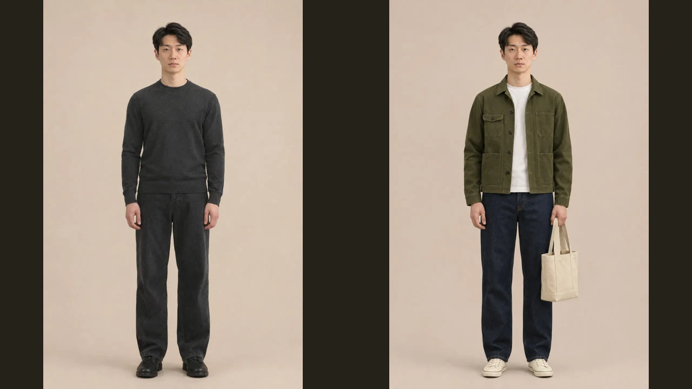

# Atelier · 个人形象工作室

先用自己的照片建立建模形象，再在同一个人身上反复试穿。Atelier 在你的 Mac 上运行，照片、衣橱、偏好、收藏和试穿记录保存在同一个本地工作空间。

[看实际建模和试穿的例子](https://www.keaton.top/projects/atelier)

## 开始使用

首版面向 macOS。准备 Node.js 24 或以上、FFmpeg（包含 `ffprobe`）和支持图片输入、图像生成的 Codex CLI 登录环境。若已有 Homebrew，可以用 `brew install node ffmpeg` 安装前两项。

1. 根据 [Codex CLI 安装指南](https://learn.chatgpt.com/docs/codex/cli) 安装 Codex，运行 `codex login` 登录。生成使用你自己的 Codex 配额和权限。
2. 下载 [Beta 源码](https://github.com/TSrain/atelier/releases) 或克隆仓库，进入目录，运行 `npm start`。
3. 打开 [http://127.0.0.1:5178](http://127.0.0.1:5178)，在设置向导上传清晰正脸、全身正面和侧脸各一张，支持 JPEG、PNG 和 WebP。
4. 照片通过检查后，点「生成建模形象」。核对全身标准照，确认后进入试衣间。
5. 选一套内置搭配，或上传一张搭配参考图。生成后可以拖动分界线对比、收藏或下载结果。

首次设置会检查本机依赖。首轮验证使用 Node.js 24.14 与 Codex CLI 0.166。出现 Codex 登录提示时，可运行 `codex login status` 后重新检测。登录成功后，实际能否出图仍取决于当前 Codex 环境的图片生成能力、网络和额度。识图失败可以重试，照片和已保存的进度留在本机。苹果 Vision 身形预览需要额外准备 Xcode Command Line Tools（`xcode-select --install`）。

如果端口被占用，运行 `PORT=5180 npm start`，再打开 `http://127.0.0.1:5180`。本服务绑定 `127.0.0.1`，面向本机单人使用。

## 照片和数据

- 创建设置、档案与历史属于本地工作空间。检查照片、分析、建模和试穿需要联网，Atelier 将所需的照片、参考图或形象信息交给配置的 Codex 服务。Codex CLI 的历史和生成缓存由它自己管理。
- 在「我的 → 推荐偏好」可以开启或暂停日常自动更新。开启后，日常穿搭、适合度、素材和读物会使用相应的 AI、天气与公开资料服务。手动发起的识图和试穿按按钮继续执行。天气推荐目前面向中国城市。
- 工作空间默认是项目下的 `data/`。用 `ATELIER_DATA_DIR=/绝对路径 npm start` 可以指定目录。
- **备份和恢复**。先在启动 Atelier 的终端按 Ctrl+C 停止服务，复制整个 `data/`（或你指定的目录）。在新安装里把副本放到数据目录，或用 `ATELIER_DATA_DIR` 直接指向备份副本。启动后检查建模照、收藏和试穿历史。一个数据目录同一时间交给一个运行中的 Atelier 使用。

## 开发

`npm test` 使用 Node 内置测试运行器。集成测试使用 FFmpeg、临时工作空间和模拟 Codex，并监听随机本机端口。代码采用 [MIT 许可证](LICENSE)，随附图像和内容见[素材说明](ASSETS.md)。
